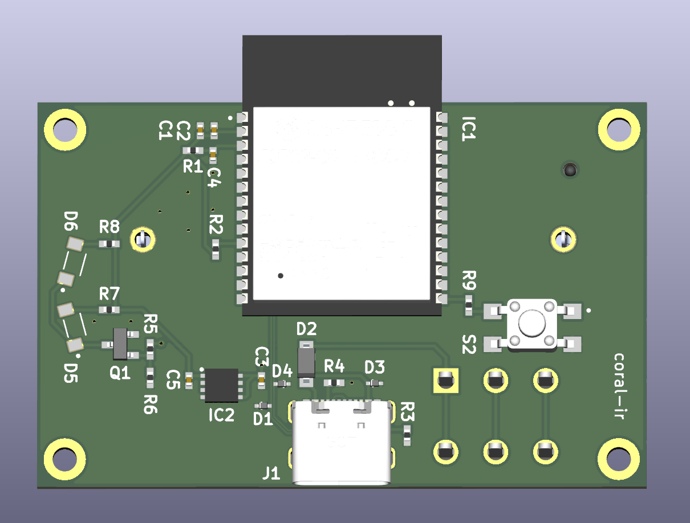
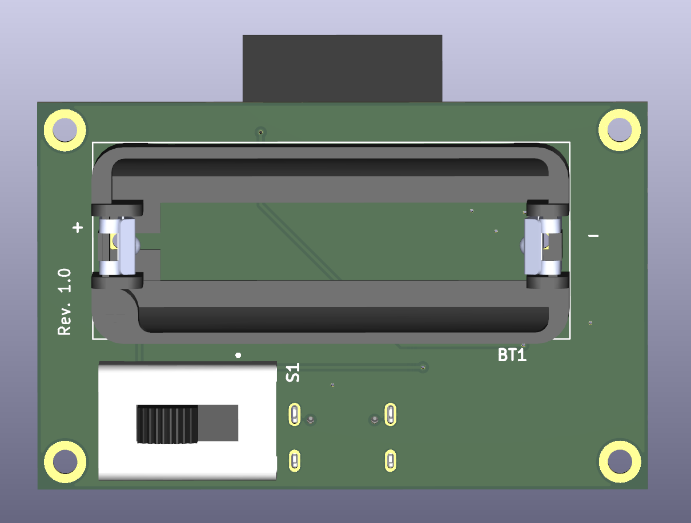

# coral-ir

**coral-ir** is a smart infrared (IR) transmitter designed for remote control of IR-enabled devices over Wi-Fi. Built around the ESP32-C6 microcontroller, this PCB project combines wireless connectivity with high-performance IR transmission in a compact design.

Top             |  Bottom
:-------------------------:|:-------------------------:
|

## Features

- **High-Performance IR Transmission**  
  Equipped with **two VSMY294310SL** high-speed, high-range 940nm infrared LEDs. Thanks to their angled placement, the board provides a wide **~100° angle**, enabling control across a large area.

- **Wi-Fi Smart Home Integration**  
  Powered by the **ESP32-C6**, enabling seamless integration with Wi-Fi networks and smart home platforms (e.g., Home Assistant, OpenHAB, etc.).

- **Multiple Power Options**  
  - **USB-C** for power and data (direct USB connection to the ESP32-C6).
  - **CR123A battery holder** for portable, untethered operation.
  - **Power source selection switch** allows users to toggle between USB and battery.

- **Compact and Efficient Design**  
  Designed with **KiCad 9**, ensuring manufacturability and open hardware practices.

## Specifications

| Feature                | Details                                          |
|------------------------|--------------------------------------------------|
| IR LEDs                | 2 × VSMY294310SL (940nm, high-speed, wide angle) |
| IR Signal Angle        | ~100°                                            |
| Microcontroller        | ESP32-C6 (Wi-Fi + USB support)                   |
| USB Interface          | USB-C (for power + data)                         |
| Battery Support        | CR123A (via holder)                              |
| Power Source Switch    | Toggle between USB (5 V) and battery (3 V)       |
| Design Software        | KiCad 9                                          |

## License

This project is open hardware and open source. License details are provided in `LICENSE`.

## Contributions

Contributions, ideas, and feedback are welcome! Please open an issue or submit a pull request.

## Links

- [ESP32-C6 Datasheet](https://www.espressif.com/en/products/socs/esp32-c6)
- [VSMY294310SL IR LED Datasheet](https://www.vishay.com/docs/84230/vsmy294310sl.pdf)
- [KiCad 9](https://www.kicad.org/)
